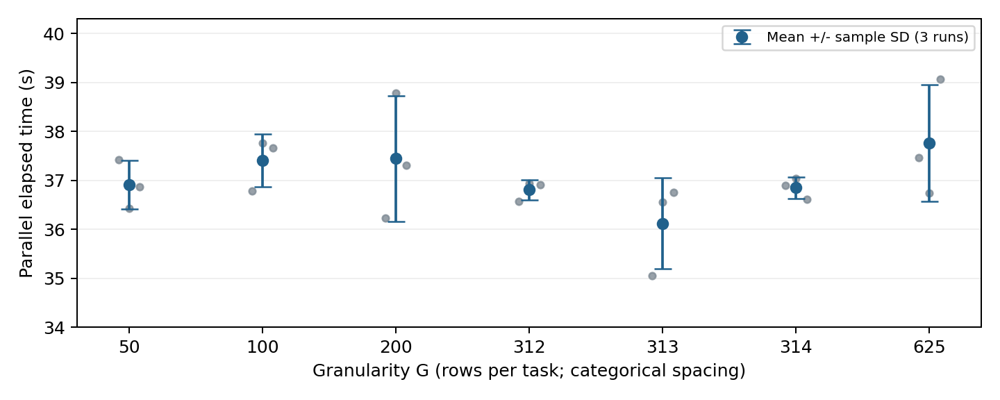

# A Toy Active Content Addressable Network

CIS5512 Lab4 | Fall 2026
Md. Mizanur Rahman | Account: tuv83848 | Daemon port used: 3848

## 1. Objective and implementation

This project extends the supplied Tuple Space daemon with shell execution and process management, then uses the resulting services for parallel matrix multiplication. The implementation is a same-machine lab prototype running on tec2. It demonstrates content-keyed coordination; it does not implement the replication or automatic crash recovery discussed in the broader ACAN introduction.

| Component | Implementation |
| Daemon and shell | tsh/tsh.c dispatches tuple and shell operations; shell_service.c tracks up to 64 jobs and invokes myshell -c. |
| Tester and API | tshtest.c includes PUT, GET, READ and all four shell operations. netlib/tshlib.c exposes shell, ps, kill and killall; tuplelib.c provides binary tuple access. Both are archived into libsng.a. |
| Launcher | tools/launch.c submits P background shell requests through the daemon. It validates P and program path and rolls back acknowledged jobs if a later launch request fails. |
| Matrix application | matrix/client.c publishes B and A stripes; worker.c reads B, claims work, computes results and exits on stop tasks. |
| Sequential controls | seq_kij.c preserves the Lab1 k-i-j order; a compile-time variant uses i-k-j to match the worker kernel. |

## Shell semantics

Foreground shell requests return after the job completes, while the daemon continues polling for tuple requests and child completion. Background requests return acceptance immediately. PS lists active shell-wrapper PIDs. KILL and KILLALL send SIGKILL to tracked process groups, including pipeline children. Program stdout/stderr remain in the daemon terminal. Launch acceptance is not proof that the child executable subsequently succeeded.

## 2. Matrix protocol and validation

For each unique run ID, the client generates reproducible A and B matrices. B is published once as a tuple and each worker obtains a non-destructive READ copy. A is partitioned into G-row stripes; the final stripe may be shorter. Each worker uses destructive GET on the run-specific task pattern, multiplies its assigned stripe by B, and PUTs a result containing the starting row. The client checks result sizes and duplicate rows, assembles C, sends P distinct stop tuples and collects P worker completion records.

Work is assigned dynamically through GET rather than fixed worker addresses. The worker kernel uses i-k-j order. Launch creates processes but does not pin them to cores. The tuple implementation matches POSIX basic regular expressions, so the matrix protocol uses anchored run-specific patterns rather than a bare wildcard.

| Evidence | Outcome and scope |
| Uploaded tec2 logs | 21 N=5000 parallel runs and six sequential runs contain sampled PASS. verify256.txt contains full verification of 65,536 cells. |
| Local review: shell | Foreground true/false/missing executable exit codes; pipe and redirection; background launch; PS; KILL; unknown PID rejection; KILLALL and reaping passed. |
| Local review: tuple API | PUT, two READs of the same tuple, destructive GET, GET waiting until PUT, and READ waiting until PUT while retaining the tuple passed. |
| Local review: launcher/matrix | Invalid count and missing executable rejected. Full checks passed for (N,G,P)=(8,2,4), (7,3,3), (5,5,4), (256,17,4). All workers completed. |
| Tester review | Menu dispatch for all requested operations inspected. Interactive PS/quit smoke test passed; not every interactive input/error path was automated. |

Local review tests are AI-assisted checks performed after upload, not new tec2 performance measurements. Commands and output are included under tests/ and evidence/. Build succeeded in all four main directories. Six warnings remain in legacy netlib/tsh/tester code (socket-length signedness, signed comparison and unused variables); build logs preserve the details.

For N<=256, verification recomputes every cell with an independent i-j-k reference. For N=5000, only 100 deterministic cells are checked. Both sequential orders produce checksum 3125109885182 in all six runs. Checksums consume the result and help detect inconsistencies, but matching checksums and sampled checks do not prove full large-matrix equality.

## 3. Experimental setup and granularity results

The saved lscpu output identifies Intel Xeon E5630 at 2.53 GHz, two sockets, four cores per socket and two threads per core: eight physical cores and sixteen logical CPUs. Thus P=16 denotes sixteen worker processes, not sixteen dedicated physical cores. The recorded compiler is GCC 13.3.0. Matrix programs use -O3 -Wall -Wextra -std=c11. The server is shared; no CPU-affinity or exclusive-allocation evidence was collected.

N=5000 and P=16 were fixed. Seven G values were each run three times. Unique run IDs separate work; restarting the idle daemon between large runs releases persistent tuples and legacy backup state. Input allocation/generation and process launch are outside the parallel timer. The timer includes B/config/task distribution, worker computation and result collection, but excludes shutdown acknowledgments and verification.

| G | Tasks | Mean (s) | Sample SD (s) | Min-max (s) |
| 50 | 100 | 36.905507 | 0.495732 | 36.431-37.420 |
| 100 | 50 | 37.403466 | 0.540392 | 36.782-37.764 |
| 200 | 25 | 37.442222 | 1.283410 | 36.229-38.786 |
| 312 | 17 | 36.803875 | 0.204272 | 36.569-36.940 |
| 313 | 16 | 36.122096 | 0.929959 | 35.055-36.759 |
| 314 | 16 | 36.851773 | 0.219346 | 36.612-37.043 |
| 625 | 8 | 37.758374 | 1.194959 | 36.735-39.071 |

## 4. Sequential comparison and interpretation

| Baseline | Mean (s) | Speedup | Efficiency / 16 |
| kij | 158.186233 | 4.379x | 27.37% |
| ikj | 126.508117 | 3.502x | 21.89% |

Speedup = mean sequential time / mean parallel time. Efficiency = speedup / 16 x 100%. The denominator 16 is the requested worker count (logical CPU count); this is not measured CPU utilization. The selected parallel mean is 36.122096 seconds at G=313.

The original Lab1 generator compiled integer matrices without an optimization flag at N=1000, 2000 and 3000. Its saved results show k-i-j fastest at 1000 and 3000, while i-k-j was slightly faster at 2000. The Lab4 baseline is an adaptation of that loop order to double, the same deterministic inputs as the parallel client, and -O3. It is not the unchanged Lab1 integer executable. Sequential timing excludes allocation, initialization, checksum and verification.

The assignment-oriented k-i-j comparison gives 4.379x speedup, but includes loop-order/cache effects. The additional i-k-j control gives 3.502x with the same loop order as workers. Neither comparison promises linear scaling: the parallel measurement also includes tuple communication and result assembly.

G=313 has the lowest mean among tested values. In the supplied first run, all sixteen workers handled one stripe. Fifteen stripes contain 313 rows and the last contains 305. At G=625, only eight tasks exist; eight workers performed zero stripes in the supplied first run. G=312 creates seventeen tasks, with a final eight-row stripe. Smaller G increases tuple operations, while larger G can reduce available parallel work. The measured curve is not monotonic, and overlapping run variation limits confidence in a unique optimum.

G=625 did not take twice as long as G=313 despite using only eight computing workers. The eight-physical-core topology, shared resource contention, memory behavior and communication are plausible contributors, but these logs do not isolate their costs. No exact attribution or simultaneous completion claim is made. Per-worker compute durations are not absolute finish timestamps. The lab granularity tradeoff is evaluated empirically; no mathematical brachistochrone equivalence is established.

## 5. Investigation of AI-assisted development

AI was used interactively for explanations, source changes, build instructions, test planning, debugging and report preparation. The student executed the commands on tec2 and supplied terminal output and project archives. This report and the final review were also AI-assisted. The accompanying ai_log.md summarizes actual stages and prompts from the dialogue; it is not presented as a complete verbatim transcript.

| Stage / question | AI contribution and verification |
| Understanding the task | Explained tuple communication and incremental work in Bangla using PuTTY and Notepad++. Work was separated into shell, API, launcher, matrix and measurement stages. |
| Shell command mode | Helped add non-interactive -c execution and exit-status propagation. Supplied terminal evidence covered true=0, false=1, missing program=127, pipes and invalid syntax. |
| Tuple waiting behavior | Reviewed status 0 / code 402 followed by callback delivery. A queued request can be pending rather than a completed failed operation. Later local tests confirmed blocking GET and READ behavior. |
| Shell integration and library | Generated staged C updates for process tracking, opcodes, API functions and build rules. Local review exercised foreground/background and management functions. |
| Launcher validation | Explained rejection of P=0 and a missing worker. A later Connection refused run led to checking that the daemon was listening on the same host and port before relaunch. |
| Experiment design | Guided G sweeps, repeats, log capture, daemon restart and nearby G tests. Failures were excluded. Actual logs, not estimated timings, determine the results. |
| Baseline review | Inspected Lab1.tar to recover flags and loop-order results. Changed int/input generation to match Lab4, consumed results using checksum, and added an i-k-j control. |

The useful pattern was to request one concrete change, compile it, test expected behavior and return the output before proceeding. AI suggestions were treated as proposals requiring verification rather than as evidence of correctness. Examples of corrections include distinguishing sampled from full verification, checking the CPU inventory instead of repeating the assignment hardware description, and separating the Lab1-order comparison from the same-order comparison.

## 6. Limitations, review findings and reproducibility

The daemon is a centralized trusted-lab service. It does not authenticate clients, replicate tuples, reassign work after worker failure or guarantee fault tolerance. Matrix tuple payloads and original protocol structs assume the same host ABI. The binary tuple API uses loopback callbacks. Shell APIs use sockets, but this submission has only been demonstrated in the same-tec2 filesystem setting; no separate physical remote-node test is claimed.

Blocking operations have no deadline/recovery mechanism; a missing worker can leave the client waiting. The interactive tester now displays READ/GET separately, bounds text input and validates text tuple length. It is still a trusted-lab prototype, not a hardened network client. Regex resources and retained tuple backup state can accumulate. These limitations were documented rather than changing the measured algorithm after the experiments. On an abandoned run, stop tracked jobs before stopping the daemon; atexit cleanup is not guaranteed on SIGINT.

The assignment goal of workers terminating at the exact same time was not measured or established. The implementation sends stop tasks after collecting all results, so apparent termination grouping would not establish balanced compute finish times. A future study should record per-worker task start/end timestamps, repeat trials in randomized order, control CPU affinity and server load, and measure communication separately.

For reproducibility, the package includes the submitted source, all successful raw measurement logs, compiler/CPU inventory, regenerated analysis.csv, the plot, functional test source and local review logs. Empty failed logs and obsolete source backups were removed. A root Makefile and sequential targets were added for rebuilding after extraction. Matrix computation source and measured raw logs were not changed; interactive tester input/output and packaging were corrected after final review. Local rebuilt binaries are convenience files; run make on tec2 before use.

## Build and run summary

Run make from the project root. Export TSHPORT, TSHHOST=127.0.0.1 and MSH_PATH pointing to the current absolute tsh/myshell path. Start tsh in one terminal. In another terminal, launch workers and run the matching client run ID. Use the README for exact commands. Use make test for the local functional suite. The optional analysis/report generation script requires Python packages reportlab and matplotlib; C program execution does not.

## Evidence sources

Supplied CIS5512 Lab4 assignment; uploaded lab4_review.tar source and results; uploaded Lab1.tar Part1/generator.sh, kij.c and results.csv; the actual AI/student dialogue; local build and functional review logs. Performance statements in this report derive from the supplied tec2 logs. No external benchmark measurements or unverified source quotations are used.

## Conclusion

The tested implementation supports tuple-driven matrix work and the four requested shell operations. Among seven tested granularities, G=313 had the lowest average runtime. Relative to the adapted Lab1 k-i-j baseline the measured speedup was 4.379x; the same-order i-k-j comparison was 3.502x. These are observed results on a shared eight-core/sixteen-thread server, with the correctness and timing limits stated above.
